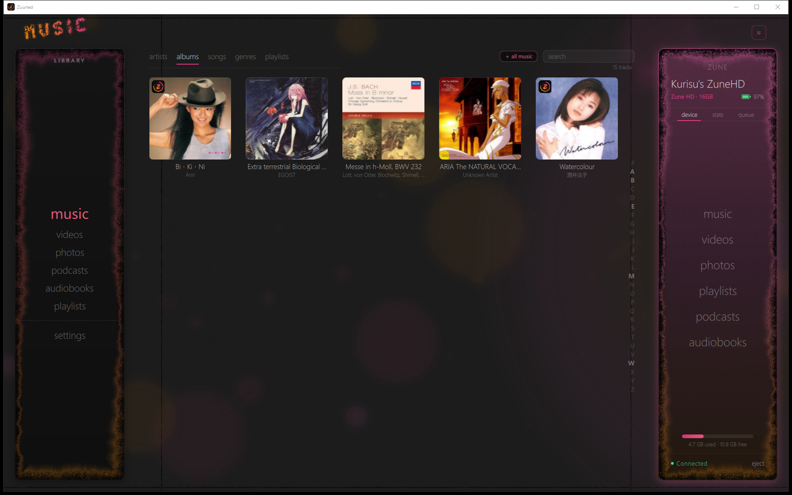
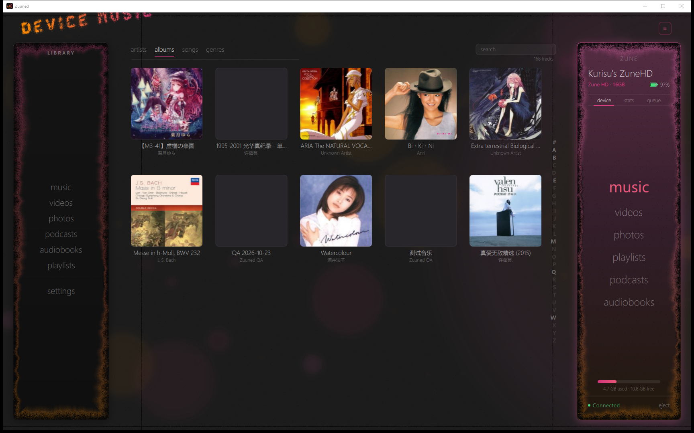
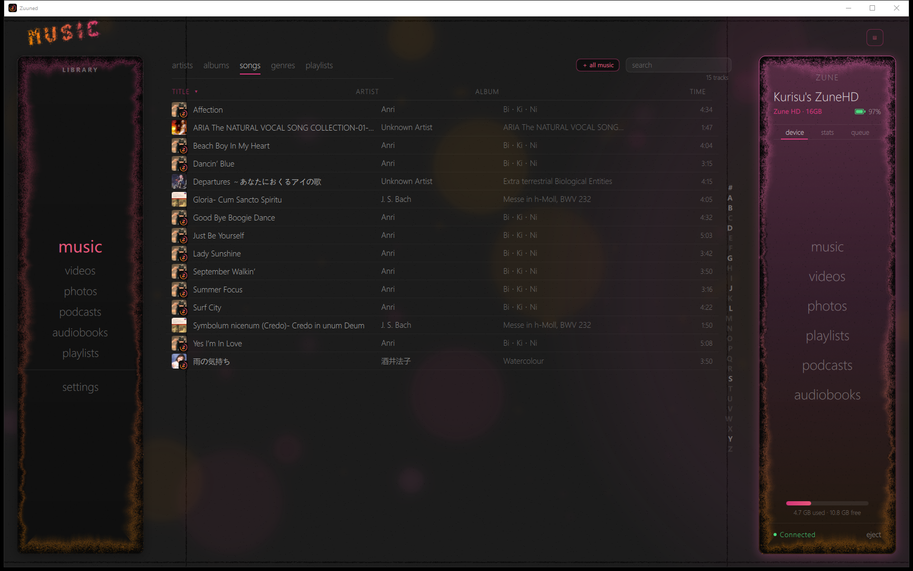
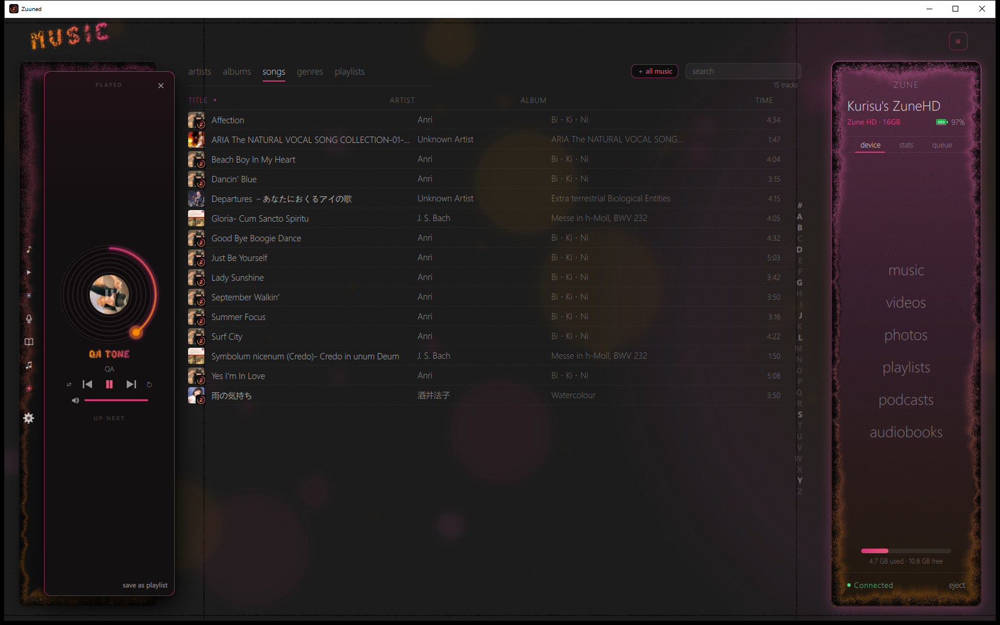
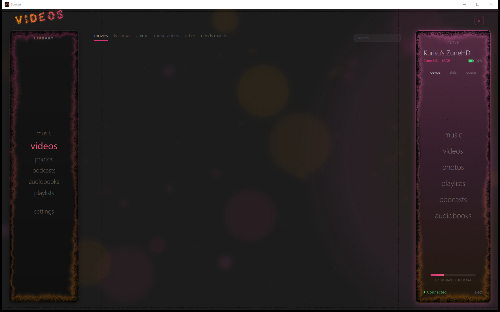
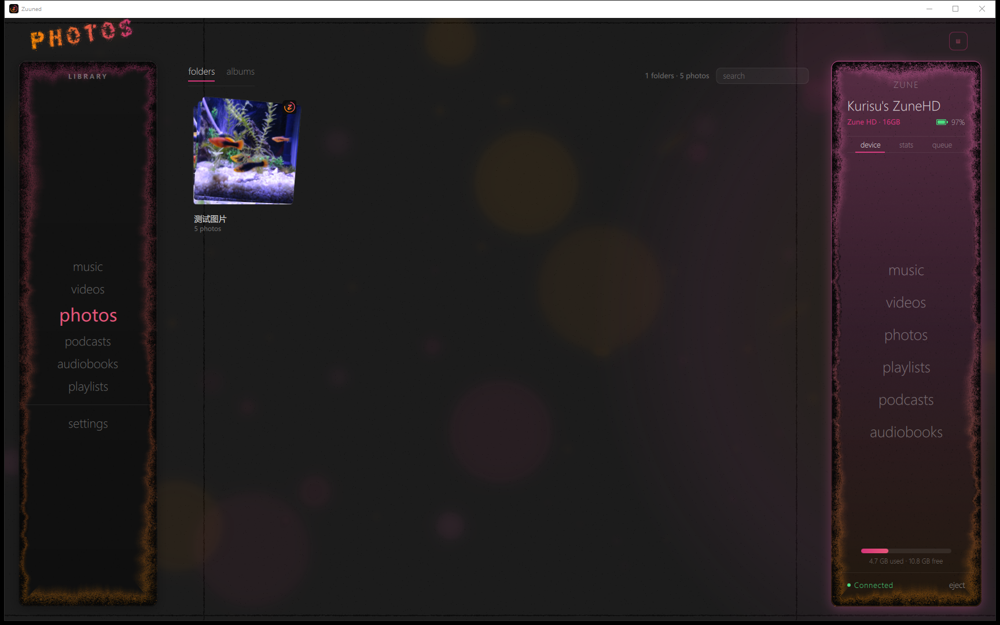
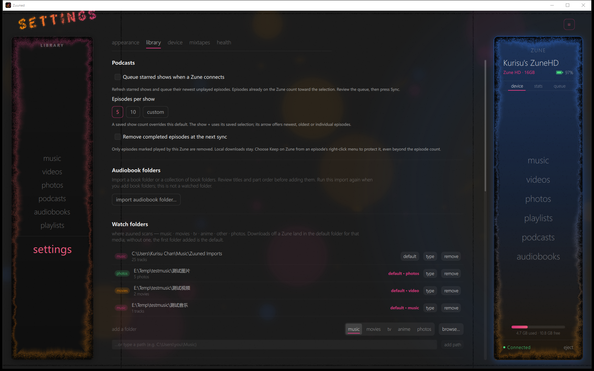

> **Public source snapshot:** read [PUBLIC_SOURCE.md](PUBLIC_SOURCE.md) for credential requirements and differences from private builds.

**English** · [简体中文](README.zh-CN.md)

# Zuuned Modern

**Bring your Zune back into the rebellion - on Windows.**

Zuuned Modern is a **Windows client port** of [Zuuned Linux](https://github.com/badgeromen/zuuned-linux),
the community app for managing Microsoft Zune players. It is the same Qt 6 / QML and
C++ application and the same [libzune](https://github.com/badgeromen/libzune) PTP/MTP/MTPZ
protocol stack, built and run natively on Windows with MSVC - no WSL, no MinGW, no
Cygwin, no virtual machine.

One source tree serves both platforms. The Windows work is additive: a
`compat/win/` layer that keeps the POSIX surface libzune and the transcode C layer are
written against, a Windows device-presence path, and native path and encoding handling
throughout. The Linux line is upstream's, and this repository exists to carry the port
until upstream wants it.

Every picture in this file and in [README.zh-CN.md](README.zh-CN.md) was captured from
`zuuned.exe` built on this repository, on Windows, with a Zune HD plugged in.



*The music page on the album pivot: cover art read out of the local files, song rows
carrying the same art, and a Pavo-generation Zune HD connected over WinUSB in the panel
at the right.*

[Status of the port](docs/WINDOWS_PORT.md) - **read that page before trusting any
hardware claim in this repository.** It records, per capability, what has been done on a
Windows machine against a real player and what has only ever been done on Linux.

## What you can do with Zuuned

Browse a Zune's library and transfer media to it over USB; enjoy a local music library
with artists, albums, playlists and playback; organize videos, podcasts and audiobooks;
edit metadata and artwork; build photo albums. Local playback and organization work with
no player connected, and each kind of media has exactly one default destination folder -
that folder shows the fact as a status on its row, the others offer it as a button. Sync
converts audio on the way to the player to whichever profile you pick under **Settings ->
Device -> Audio conversion**, WMA Lossless included; that target is written by the encoder
the operating system already ships rather than by a bundled codec, and it refuses rather
than quietly downgrading to lossy. The Windows port carries music in both directions
against a player and takes music back off it, one track at a time, with the player
agreeing in a later session; photos and video have been sent from Windows without a byte
of either coming back - see the status page.

## The pages

| | |
| --- | --- |
|  | **The device page.** What is actually on the player - artists, albums, songs and genres browsed off the Zune, with album pictures fetched over USB rather than looked up anywhere. |
|  | **The song list.** One row per track with its own thumbnail, sortable, searchable, and the same rows the queue is built from. |
|  | **Now playing.** The vinyl island over the library. The playing row here comes from the app's own QA hook, so it is labelled `QA tone` rather than by its tags. |
|  | **Videos**, with the profile each movie will be converted to before it can go onto a player. |
|  | **Photos**, and the photo albums you build out of them for the player. |
|  | **Settings - Library.** Watch folders spelled the way Windows spells them, one default destination per media kind, podcast and audiobook import. |

The rest of the captures, if you want to see them at full size:
[welcome](docs/readme-screenshots/welcome.png),
[artists](docs/readme-screenshots/music-artists.png),
[the device artist grid](docs/readme-screenshots/device-music.png),
[podcasts](docs/readme-screenshots/podcasts.png),
[audiobooks](docs/readme-screenshots/audiobooks.png),
[Settings - Appearance](docs/readme-screenshots/settings-appearance.png),
[Settings - Device](docs/readme-screenshots/settings-device.png),
[Settings - Mixtapes](docs/readme-screenshots/settings-mixtapes.png),
[Settings - Health](docs/readme-screenshots/settings-health.png).
Chinese copies of all of them live in
[docs/readme-screenshots/zh/](docs/readme-screenshots/zh).

## Interface language

**Settings -> Appearance -> Language** writes the interface in English or
简体中文, or follows the Windows display language. It is read once, at launch, and the
card says so and tells you which one is on screen right now.

The wording is a file, not a code change: `i18n/zh_CN.tsv` holds every message and its
Chinese, `i18n/zuuned_zh_CN.ts` is the Qt translation source built from it, and
`python i18n/audit.py` fails the tree when a piece of interface text is typed straight
into QML or C++ where no translation could ever reach it. So rewording the interface is
an edit and a restart, and a third language is a new file rather than a refactor. See
[docs/I18N.md](docs/I18N.md).

Names, tags, file paths and what the Zune itself displays are never translated - only
what zuuned says.

## What has actually been done on Windows

Hand-tested against one Pavo-generation Zune HD on the development machine:

- **Driver binding** - the player bound to WinUSB, read back as `CM_PROB_NONE` with an
  interface GUID ([`packaging/windows/DRIVER_INSTALL.md`](packaging/windows/DRIVER_INSTALL.md)).
- **Enumeration and hotplug** - unplug and replug produced the same read twice.
- **Reading the device** - `GetDeviceInfo`, the ZMDB scan, the device page browsed with
  album thumbnails fetched off the player.
- **Authenticated transfers, both ways, through the ordinary controls** - two tracks sent
  to the player, one of them on an album named in Chinese, and a track pulled back into the
  local library with byte readback. A pull lands in the folder the library declares for
  music, not in a directory of the app's own choosing.
- **Local library on a Windows disk** - watch folders, native `E:\...` path display,
  non-ASCII file names, album artwork.
- **WMA Lossless end to end** - a FLAC master encoded by the encoder Windows already ships, sent
  to the player, taken back with PCM that still hashes to the master's, and played on the HD. The
  container that comes back is not the one that went out: a Zune re-wraps an ASF on ingest and
  rewrites the Author inside the file from the name it holds device-side, so the invariant for this
  format is the codec tag the player serves plus the decoded samples, never the bytes.
- **Deletion** - one music track purged through the right-click control, and the next
  launch read 168 tracks in 10 albums by 10 artists back off the player with its own free
  space 18.5 MB larger. The agreement is the device's, not a row dropped from a list.

**Not yet proven on Windows**, and not inherited from Linux either: any deletion beyond
that one music track, the podcast, audiobook, photo and video transfer categories, every Zune
model but that one Pavo, audible PC-side playback (the automated gate opens WASAPI muted, so
no automated run has heard anything), and packaging - there is no Windows installer yet, so today the
port is a build-from-source project. **WMA Lossless** is encoded on Windows, by the encoder the
operating system already ships rather than a bundled codec, and a track written that way has now
been heard on the HD; the format is documented for the Zune HD alone, so no other model has been
offered one and the setting says out loud that the likely result elsewhere is a silent track.

## Getting a Zune seen by Windows

libusb cannot see a Zune that has no driver bound, and Windows ships none for one. An
unbound player sits at PnP *problem 28* and appears nowhere. Binding is a one-time manual
step per machine and **nothing in Zuuned installs a driver**:

1. Plug the player in and run [`packaging/windows/check-driver.ps1`](packaging/windows/check-driver.ps1)
   to see what Windows thinks it has.
2. If it is unbound, follow
   [`packaging/windows/DRIVER_INSTALL.md`](packaging/windows/DRIVER_INSTALL.md) - the short
   version is *use Zadig and pick the device id that script prints*. Do not hand-write an
   INF, and do not install the Zune software.
3. Replug. The app then says plainly whether it can use what is plugged in.

## Build on Windows

The full, current recipe is
[the Windows section of BUILDING.md](BUILDING.md#build-on-windows). Short version:

- Visual Studio 2022 (`msvc2022_64`), CMake, Ninja
- Qt 6.11 for MSVC 2022 64-bit
- a vcpkg tree, or a `ZUUNED_WIN_DEPS` tree, for libusb, libgcrypt, SQLite, mpv, FFmpeg
  and LAME
- load the MSVC environment (`vcvars64.bat`) before configuring - loading none, or the
  one belonging to a different Visual Studio, fails as a flood of bogus `std::thread`
  diagnostics or an `STL1001` static assert rather than as a linker error
- MTPZ authentication data, unless you want the read-only case. This source ships no
  credentials, so a build without them browses a player and answers `AccessDenied` or a
  raw `0x200F` the moment it writes to one: the symptom reads like a platform fault and is
  not one. Put the five-line file at `%USERPROFILE%\.mtpz-data`, which needs no rebuild, or
  create `libzune\src\mtpz_keys.h` - [docs/BUILD_WITH_MTPZ.md](docs/BUILD_WITH_MTPZ.md)

```powershell
git clone https://github.com/miemiekurisu/zuuned-modern.git
cd zuuned-modern
cmake -B build -G Ninja
cmake --build build --clean-first
build\zuuned.exe
```

`--clean-first` is not a stylistic preference on this platform: on a localized Windows
install Ninja records zero header dependencies, so an incremental build after a header
edit quietly relinks stale objects. `BUILDING.md` explains, with the upstream issue
numbers.

Two software gates ship with the tree and neither one touches a player:

```powershell
pwsh -NoProfile -ExecutionPolicy Bypass -File tests\win-compat\run.ps1
pwsh -NoProfile -ExecutionPolicy Bypass -File tests\win-usability\run.ps1
```

They cover the POSIX-compatibility layer and launch every page, every settings tab, the
filename and library probes, plus the command-line self-tests that ride inside it -
`librarytool names`, `paths`, `customize`, `folders`, `vanish`, `videofloor`, `census`,
`cover` and `net`, `transcodetool retagcheck` and `copycheck`, and `mtpframingtool` - all
run against isolated profiles. A green run on 2026-10-29 reported
`201 checks, 0 failures, 0 skips` and
`launches=18 checks=134 failures=0 skips=1 killed=0`, the single skip being the two checks
that name a specific device with no Zune attached to compare. Those counters move with the
tree, so read them as a floor rather than an expectation. Neither gate says anything at
all about a Zune - that is deliberate, and is why the hardware evidence lives on
[docs/WINDOWS_PORT.md](docs/WINDOWS_PORT.md) instead.

## Building on Linux

The upstream instructions still apply and are unchanged by the port: see
[BUILDING.md](BUILDING.md), [docs/BUILD_WITH_MTPZ.md](docs/BUILD_WITH_MTPZ.md) for Zune
authentication data, and the upstream
[badgeromen/zuuned-linux](https://github.com/badgeromen/zuuned-linux) repository for
released Linux packages, the AppImage workflow and the udev rule. This repository builds
Linux too, but it publishes no Linux binaries. The Linux software gates ship here as well:
`ci/check.sh` drives the other directories under `tests/` - music import and sync,
artwork, spoken media, playlists, diagnostics and the rest - on a Linux machine, which is
the only place that suite runs.

## Reporting a problem

Open **Settings -> Health -> export debug report**, read the saved text, and attach it to
an issue here. Say which platform and build, the Zune model, and the steps. Logs are under
`%LOCALAPPDATA%\Zuuned\Zuuned\State\logs\` on Windows and
`~/.local/state/Zuuned/Zuuned/logs/` on Linux; settings are an ini file under
`%APPDATA%\Zuuned` on Windows. Reports never upload themselves. See
[docs/DIAGNOSTICS.md](docs/DIAGNOSTICS.md).

## Layout

```
src/            C++; DeviceService (libzune bridge), app entry
qml/            UI; Theme.qml design tokens
compat/win/     the Windows POSIX surface, built once as zuuned_wincompat
libzune/        included source; shared C protocol library
libzune/tools/  zunetool and mtpframingtool, the protocol-side probes
transcode/      FFmpeg and LAME transcoding, plus the in-box WMA Lossless encoder
i18n/           the interface wording; zh_CN.tsv is the editable source
packaging/      Linux USB rule, PKGBUILD and AppImage builder
packaging/windows/  WinUSB driver guide and check-driver.ps1
tests/win-compat/    Windows compatibility gate (no device)
tests/win-usability/ Windows launch and UI gate (no device)
tests/            the Linux gate suite, driven by ci/check.sh (no device)
docs/readme-screenshots/  these captures, and the zh/ set
docs/WINDOWS_PORT.md what is and is not proven on Windows
docs/WINDOWS_COMPAT_AUDIT.md the whole-tree Windows compatibility sweeps
docs/SETTINGS_INVENTORY.md every switch, and the feature behind each one
docs/FEATURE_COMPLETION.md the implementation backlog
docs/ZUNE_CLIENT_FEATURES.md the original Zune software, feature by feature
```

## License

Original Zuuned application code is licensed under **GPL-3.0-or-later**. See
[LICENSE](LICENSE) and [licensing scope](COPYING.md). Third-party components retain their
own licenses and attribution. libzune has its own repository.

Zuuned is an independent community project, not affiliated with or endorsed by Microsoft.
Zune is a trademark of Microsoft Corporation.
