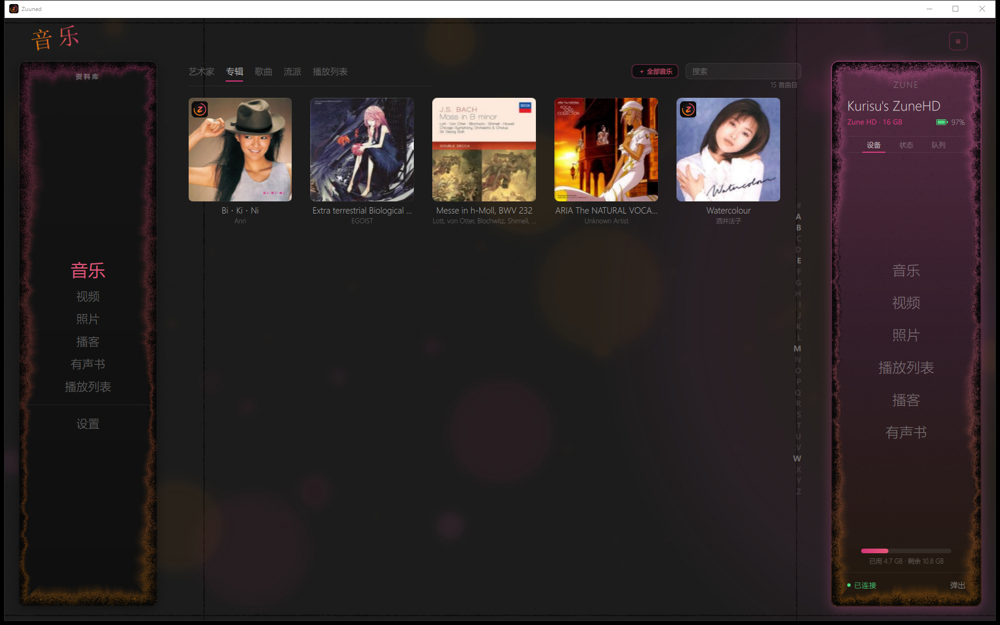
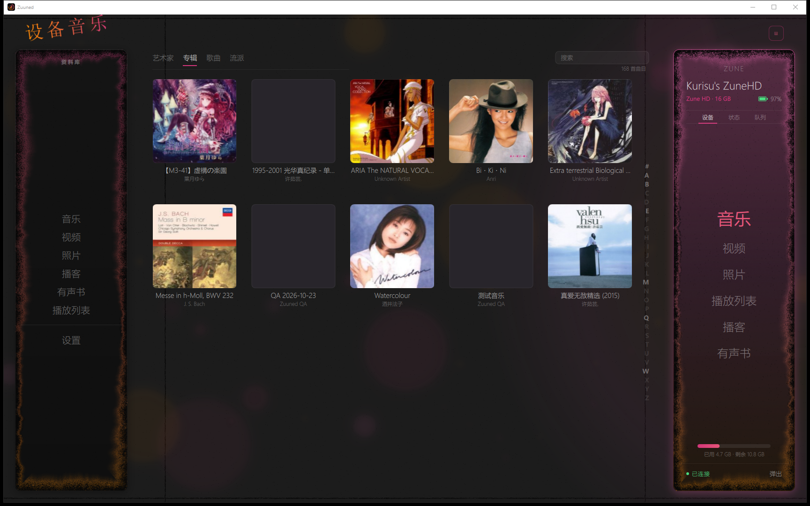
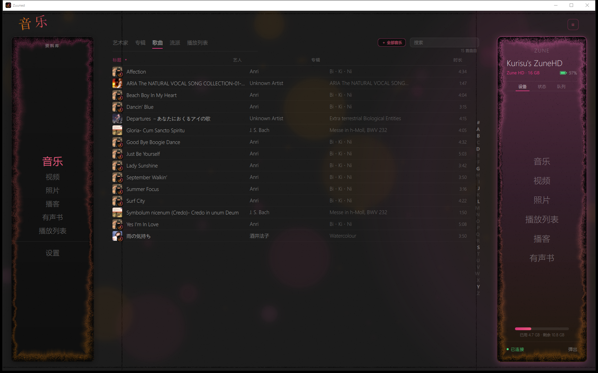
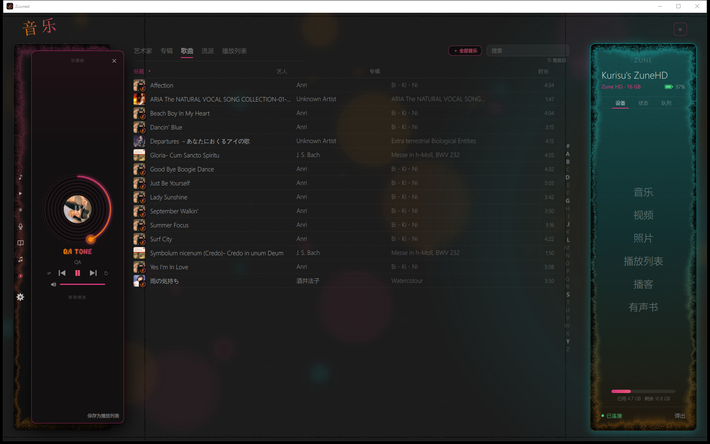
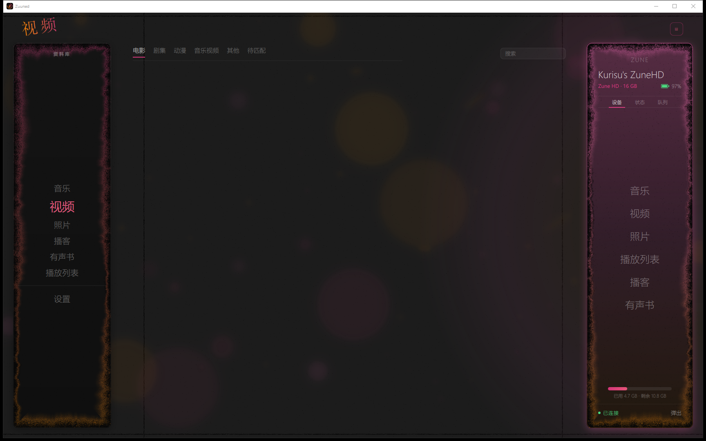
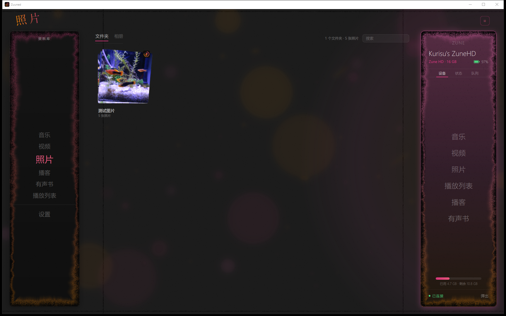
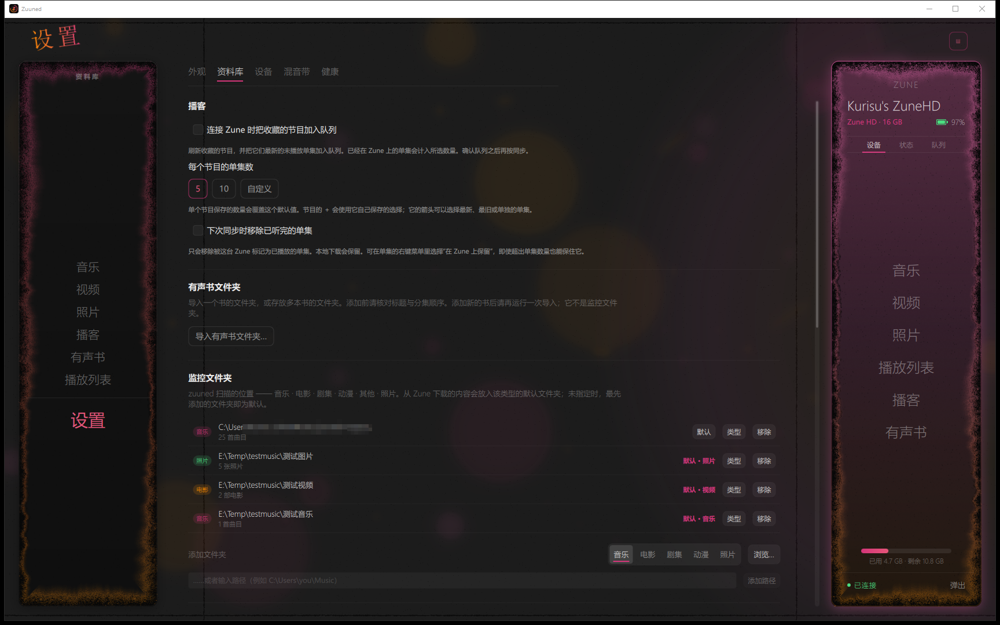

> **公共源码快照：**凭据要求以及与私有构建的差异请读 [PUBLIC_SOURCE.md](PUBLIC_SOURCE.md)。

[English](README.md) · **简体中文**

# Zuuned Modern

**让你的 Zune 重回这场反叛——在 Windows 和 Apple silicon 上。**

Zuuned Modern 是 [Zuuned Linux](https://github.com/badgeromen/zuuned-linux) 的 **Windows
客户端移植**，Zuuned Linux 是社区为微软 Zune 播放器写的管理应用。这里是同一个
Qt 6 / QML 与 C++ 应用，也是同一套 [libzune](https://github.com/badgeromen/libzune)
PTP/MTP/MTPZ 协议栈，用 MSVC 在 Windows 上原生构建、原生运行——没有 WSL，没有 MinGW，
没有 Cygwin，没有虚拟机。

同一套源码同时服务三个平台。Windows 的部分全是增量：一个 `compat/win/` 层，让 libzune 和
转码 C 层继续写它们所依赖的 POSIX 接口；一条 Windows 设备在位检测路径；以及贯穿全局的原生
路径与编码处理。Linux 那条线属于上游，本仓库负责把移植带着走，直到上游愿意接手。

同一棵树在 Apple silicon 上也是原生构建、原生运行：Qt 6 加 Homebrew 依赖，走的是 Linux 用的
那条用户态 libusb 路径，而不是苹果的驱动，没有 kext 也没有 DriverKit 扩展——DEXT 不经过苹果
自己的公证根本加载不了，而这个项目没有苹果开发者授权。2026-11-06 这个构建在 Mac 上打开、鉴权、
读取、写入了一台真实的 Zune HD，并且从上面删掉过一首歌。

本文件与 [README.md](README.md) 里的每一张图，都是在 Windows 上用本仓库构建出的
`zuuned.exe` 截取的，并且当时插着一台 Zune HD。



*音乐页的专辑视图：封面从本地文件里读出来，歌曲行带着同一批封面，右侧面板里是一台通过
WinUSB 连接的 Pavo 世代 Zune HD。*

[Windows 移植状态](docs/WINDOWS_PORT.md) 与 [macOS 移植状态](docs/MACOS_PORT.md)——
**在本仓库相信任何硬件结论之前，先读那两页。**它们按能力逐项记录：哪些是在 Windows 或
Apple silicon 机器上对真实播放器做过的，哪些至今只在 Linux 上做过。

## 你能用 Zuuned 做什么

通过 USB 浏览 Zune 的资料库并往里传媒体；享受一个有艺术家、专辑、播放列表和本地播放的本地
音乐库；整理视频、播客与有声书；编辑元数据与封面；组建照片相册。不接播放器时，本地播放与
整理照常工作，并且每一类媒体只有一个默认目标目录——那一个目录在自己的行上把这个事实显示成
状态，其余目录把它显示成一个按钮。同步到播放器时，音频按
**设置 -> 设备 -> 音频转换** 里选定的规格转码，WMA 无损也在其中；那个目标由 Windows 本来就
自带的那个编码器写出来，而不是随程序附带一个编码器，做不到就直接拒绝，不会悄悄降级成有损。
Windows 移植已经与播放器双向传过音乐，也会把音乐从播放器上一条一条取回来，而且下一次会话里
播放器自己也认了账；照片与视频从 Windows 发过去过，但一个字节都没有回来过——见状态页。

## 各个界面

| | |
| --- | --- |
|  | **设备页。**播放器里真实存在的东西——艺术家、专辑、歌曲与流派都在 Zune 上浏览，专辑图也是从 USB 取来的，不是去哪里查出来的。 |
|  | **歌曲列表。**每首歌一行，各自带缩略图，可排序、可搜索，队列用的就是这些行。 |
|  | **正在播放。**资料库上方的那张黑胶岛。这里的播放行来自应用自己的 QA 钩子，所以它标的是 `QA tone`，不是标签里的名字。 |
|  | **视频**，以及每部影片在放进播放器之前要转换成的目标 profile。 |
|  | **照片**，以及你为播放器用它们组建的照片相册。 |
|  | **设置 - 资料库。**监控文件夹按 Windows 的写法显示，每一类媒体一个默认目标目录，以及播客与有声书导入。 |

其余截图，想看原始尺寸的话：
[欢迎页](docs/readme-screenshots/zh/welcome.png)、
[艺术家](docs/readme-screenshots/zh/music-artists.png)、
[设备艺术家墙](docs/readme-screenshots/zh/device-music.png)、
[播客](docs/readme-screenshots/zh/podcasts.png)、
[有声书](docs/readme-screenshots/zh/audiobooks.png)、
[设置 - 外观](docs/readme-screenshots/zh/settings-appearance.png)、
[设置 - 设备](docs/readme-screenshots/zh/settings-device.png)、
[设置 - 混音带](docs/readme-screenshots/zh/settings-mixtapes.png)、
[设置 - 健康](docs/readme-screenshots/zh/settings-health.png)。
英文原图在 [docs/readme-screenshots/](docs/readme-screenshots)。

## 界面语言

**设置 -> 外观 -> 语言**把界面写成英文或简体中文，或者跟随 Windows 的显示语言。它只在启动时
读取一次，卡片上写明了这一点，并告诉你屏幕上现在是哪一种。

措辞是一个文件，不是一次代码改动：`i18n/zh_CN.tsv` 保存每一条消息和它的中文，
`i18n/zuuned_zh_CN.ts` 是由它生成的 Qt 翻译源，`python i18n/audit.py` 会在有任何界面文字被
直接写进 QML 或 C++（翻译永远够不着的地方）时让整棵树失败。所以改界面措辞就是改一个文件再
重启，加第三种语言就是加一个文件，而不是一次重构。见 [docs/I18N.md](docs/I18N.md)。

名字、标签、文件路径以及 Zune 自己显示的内容永不翻译——只翻译 zuuned 自己说的话。

## 在 Windows 上实际做到了哪一步

在开发机上对一台 Pavo 世代的 Zune HD 做过手工实测：

- **驱动绑定**——播放器绑定到 WinUSB，读回 `CM_PROB_NONE` 和一个接口 GUID
  （[`packaging/windows/DRIVER_INSTALL.md`](packaging/windows/DRIVER_INSTALL.md)）。
- **枚举与热插拔**——拔下再插上，两次得到同一份读取结果。
- **读取设备**——`GetDeviceInfo`、ZMDB 扫描、设备页可以浏览，专辑缩略图取自播放器本身。
- **带鉴权的传输，两个方向，用的就是普通控件**——两首歌发进播放器，其中一张专辑的名字是
  中文；另一首从设备拉回本地资料库并做了逐字节回读。拉取落在资料库为音乐声明的那个目录里，
  不是应用自己挑的一个目录。
- **Windows 磁盘上的本地资料库**——监控文件夹、`E:\...` 原生路径显示、非 ASCII 文件名、
  专辑封面。
- **WMA 无损端到端**——一张 FLAC 母带用 Windows 自带的编码器编码、发进播放器、再取回一份解码后
  PCM 仍然与母带同哈希的文件，并且这首曲目在 HD 上真实播放过。取回来的容器并不是发出去的那一个——
  Zune 入库时会重新封装 ASF，并且用设备那一侧的艺术家名重写文件里面的 Author——所以这个格式真正的
  不变量是播放器给出的 codec tag 和解码出来的采样，而不是字节。
- **删除**——通过右键控件清除过一条音乐曲目，而下一次启动从播放器读回 168 首歌、10 张专辑、
  10 位艺术家，播放器自己报出的可用空间也多了 18.5 MB。这份确认来自播放器本身，不是本地列表少了一行。

**在 Windows 上尚未证实**，也不会从 Linux 继承过来：除了那一条音乐曲目之外的任何删除、播客、有声书、
照片和视频这些传输类别、那台 Pavo 之外的每一个 Zune 型号、听得见的 PC 端播放（自动化门禁是静音打开
WASAPI 的，所以没有任何一次测试真正听过声音），以及把打包出来的那个目录接上播放器、或者在一台没有
构建过它的机器上打开——现在有一个预览制品了，但仍然没有安装包，也没有代码签名。**WMA 无损**在
Windows 上是可以编码的，用的是操作系统自带的那个编码器而不是随程序附带一个；PCM 往返逐位相同，而且这
样一首曲目已经在 HD 上播放过了。这个格式只有 Zune HD
有文档支持，所以设置项里也明说了：在别的机型上更可能的结果是那一首不出声。

## 让 Windows 认出 Zune

没有绑定驱动的 Zune，libusb 看不见，而 Windows 自己不带这个驱动。未绑定的播放器停在 PnP
*问题 28*，在任何设备列表里都不出现。绑定是每台机器一次的手工步骤，而且
**Zuuned 里没有任何东西会安装驱动**：

1. 插上播放器，运行 [`packaging/windows/check-driver.ps1`](packaging/windows/check-driver.ps1)
   看看 Windows 认为自己手上是什么。
2. 如果它未绑定，照
   [`packaging/windows/DRIVER_INSTALL.md`](packaging/windows/DRIVER_INSTALL.md) 做——短版本是
   *用 Zadig，并选中那个脚本打印出来的设备 id*。不要手写 INF，也不要装 Zune 软件。
3. 重新插拔。之后应用会直接说清它能不能用当前插着的东西。

## 在 Windows 上构建

完整、当前的配方是
[BUILDING.md 的 Windows 一节](BUILDING.md#build-on-windows)。简版：

- Visual Studio 2022（`msvc2022_64`）、CMake、Ninja
- 面向 MSVC 2022 64 位的 Qt 6.11
- 一个 vcpkg 树，或一个 `ZUUNED_WIN_DEPS` 树，提供 libusb、libgcrypt、SQLite、mpv、FFmpeg
  和 LAME
- 配置之前先加载 MSVC 环境（`vcvars64.bat`）——完全不加载，或者加载了另一个 Visual Studio
  的那一套，报错形式是一大片假的 `std::thread` 诊断，或者一个 `STL1001` static assert，而不
  是链接错误
- MTPZ 鉴权数据，除非你只要只读那一种情形。这份源码不带任何凭据，因此没有凭据的构建可以浏览
  播放器，但一旦对它写入就返回 `AccessDenied` 或裸的 `0x200F`：症状读起来像平台故障，而它
  并不是。把那五行文件放到 `%USERPROFILE%\.mtpz-data`，无需重新构建；或者创建
  `libzune\src\mtpz_keys.h`——见 [docs/BUILD_WITH_MTPZ.md](docs/BUILD_WITH_MTPZ.md)

```powershell
git clone https://github.com/miemiekurisu/zuuned-modern.git
cd zuuned-modern
cmake -B build -G Ninja
cmake --build build --clean-first
build\zuuned.exe
```

在这个平台上 `--clean-first` 不是风格偏好：在本地化过的 Windows 安装上 Ninja 记录到的头文件
依赖是零，所以改完头文件做一次增量构建，会安静地链接上陈旧的目标文件。`BUILDING.md` 里有
解释，并附上上游 issue 编号。

树里带两个纯软件门禁，两个都不碰播放器：

```powershell
pwsh -NoProfile -ExecutionPolicy Bypass -File tests\win-compat\run.ps1
pwsh -NoProfile -ExecutionPolicy Bypass -File tests\win-usability\run.ps1
```

它们覆盖 POSIX 兼容层，并在隔离的 profile 里启动每一个页面、每一个设置页签、文件名与资料库
探针，以及跑在它内部的命令行自检——`librarytool names`、`paths`、`customize`、`folders`、
`vanish`、`videofloor`、`census`、`cover`、`net`，`transcodetool retagcheck` 与 `copycheck`，
还有 `mtpframingtool`。2026-10-29 的一次全绿运行报出 `201 checks, 0 failures, 0 skips` 和
`launches=18 checks=134 failures=0 skips=1 killed=0`，那一个 skip 是没接 Zune 时跳过的
那两条点名具体设备的检查。这些计数会随代码移动，请把它们当下限而不是预期值。两个门禁对
Zune 一个字都不说——这是故意的，也正是硬件证据放在
[docs/WINDOWS_PORT.md](docs/WINDOWS_PORT.md) 而不是这里的原因。

### 一个不需要这套工具链也能跑的目录

构建树只在工具链所在的那台机器上跑。[`packaging/windows/deploy.ps1`](packaging/windows/deploy.ps1)
把它变成一个离开工具链也能跑的目录，并且用唯一能真正说明问题的方式来证明这件事——用一条只点名这个
目录自己的 `PATH` 去启动包里的 `zuuned.exe`，然后读加载器真正映射了哪些 DLL：

```powershell
pwsh -NoProfile -ExecutionPolicy Bypass -File packaging\windows\deploy.ps1 -Out E:\Temp\zuuned-package
```

它用 `windeployqt` 把 Qt 运行时和它的 QML 模块搬进来，再放上 FFmpeg 工具、`libmpv`、SQLite、libusb、
LAME 与 VC++ 运行时、中文语言目录、驱动文档，以及一份把测过和没测过都写明白的 `README-Windows.txt`；
它从已编译的可执行文件里把 manifest 读回来核对，清点包里每一个二进制的导入表，确认源码 import 的每一个
QML 模块都到位，最后为 `.zip` 打出一个 SHA-256。2026-11-08 的一次全绿运行在 1,556 个文件、176.8 MB
的归档上报出 `31 checks, 0 failures`，其中 58 个模块从包内映射、135 个来自 Windows、没有一个来自开发
目录。它不编译任何东西、不装驱动、不开设备句柄、不签名、也不生成安装包：这个制品是预览版，它携带的设备
证据就是构建树那一份，不是新的一份。

## 在 macOS（Apple silicon）上实际做到了哪一步

在一台 Apple silicon 的 Mac 上，对同一台 Pavo 世代的 Zune HD 做过手工实测，一共三次会话，
会话之间把播放器拔下再插上：

- **不需要驱动，也确实什么都没装**——macOS 不给这个设备绑定任何驱动，所以不装任何东西
  libusb 就能看见 `045e:063e`，并且第一次尝试就 claim 到了接口 0。
  [`packaging/macos/claimprobe.c`](packaging/macos/claimprobe.c) 把这份观测打印出来，端点
  也一并列出。没有安装、没有绑定、没有为内核签名，也没有 Zadig 这一步：DriverKit 扩展是
  有意排除在构建之外的，因为 DEXT 不经苹果自己的公证就加载不了，而本项目拿不到那个授权。
- **读取设备**——`GetDeviceInfo`、Pavo 的机型读取、整份 224,928 字节的 ZMDB 负载，以及设备
  页上浏览到的 168 首歌、10 张专辑、10 位艺术家。
- **用内置密钥完成的 MTPZ 鉴权**——这次是刻意把 `~/.mtpz-data` 删掉之后测的；正是这一点让
  下面每一条写路径都成为可达的。
- **一次音乐上传，判断依据是取回来的东西**——一个没有 ID3v2 标签的 MP3 用普通控件发了进去；
  播放器自己报的可用空间为一个 193,097 字节的文件少了 196,608 字节，专辑数与曲目数各加一，
  有界的重连阶梯在第 1 次尝试就读回 169 首，没有人点过任何按钮。第二次会话再把它取下来时，
  文件落在资料库为音乐声明的那个目录里，因为设备自己写标签而大了 1,186 字节，而音频帧和
  两边各自解码出来的采样哈希都对得上。
- **删除**——用右键控件清除，第三次会话从播放器读回 168 首歌，可用空间大了 194,283 字节——
  正好等于刚从它上面取回的那个文件的大小。
- **插入方向的热插拔**——三次会话，三条 `Zune arrived`，来自 libusb 回调而不是轮询兜底那条。
- **打包**——[`packaging/macos/deploy.sh`](packaging/macos/deploy.sh) 产出自包含 bundle、
  一个 `.dmg` 和一个 zip，两个归档都按使用者打开它们的方式验证过。Windows 至今还没有安装包，但
  2026-11-08 起 [`packaging/windows/deploy.ps1`](packaging/windows/deploy.ps1) 产出同类的自包含目录
  与 zip，见上文。

**在 macOS 上尚未证实**，也不会从 Windows 或 Linux 继承过来：除了那一条音乐曲目之外的任何删除、
播客、有声书、照片与视频这些传输类别、那台 Pavo 之外的每一个 Zune 型号、听得见的 Mac 端播放
（CoreAudio 量到能绑定、播放头能往前走，但没有人听过）、热插拔的**拔出**那一半——`Zune left`
在这里的 macOS 日志里一次都没有出现过——以及那个打包好的 bundle 接上播放器的情况，因为上面的
设备证据来自构建树里的 bundle。播放器至今还会答的那几个响应码、缩略图的失败、以及构建里为什么
没有 DEXT，都写在 [docs/MACOS_PORT.md](docs/MACOS_PORT.md) 上。

## 在 macOS（Apple silicon）上构建

完整、当前的配方是
[BUILDING.md 的 macOS 一节](BUILDING.md#build-on-macosapple-silicon)。简版：

- Xcode 命令行工具、CMake、Ninja
- Homebrew 提供 Qt、libusb、libgcrypt、SQLite、mpv、FFmpeg 与 LAME
- MTPZ 鉴权数据，除非你只要只读那一种情况——和其他平台一样的那五行文件，放在
  `~/.mtpz-data`，或者创建 `libzune/src/mtpz_keys.h`
  （[docs/BUILD_WITH_MTPZ.md](docs/BUILD_WITH_MTPZ.md)）

```bash
git clone https://github.com/miemiekurisu/zuuned-modern.git
cd zuuned-modern
cmake -B build-macos-release -G Ninja -DCMAKE_BUILD_TYPE=Release
cmake --build build-macos-release --parallel 8
./build-macos-release/zuuned.app/Contents/MacOS/zuuned
```

`./packaging/macos/deploy.sh` 把这棵树变成自包含 bundle 和两个归档。这个项目背后没有苹果开发者
授权，所以没有任何公证可言：第一次启动要么右键 -> 打开，要么
`xattr -dr com.apple.quarantine`；而且建在 `~/Documents` 下面的 bundle 还要答一次「文稿」文件夹
的隐私授权，因为 macOS 把音乐文件夹放在那里。

任何碰播放器、碰视频解码器、碰音频设备的命令都要在**沙箱之外**跑。沙箱里 libusb 会枚举出零个
设备，VideoToolbox 会拒绝它的会话，两者看起来都像构建坏了，而实际上只是权限被拒。

## 在 Linux 上构建

上游的说明依然适用，移植没有改动它们：见 [BUILDING.md](BUILDING.md)、Zune 鉴权数据的
[docs/BUILD_WITH_MTPZ.md](docs/BUILD_WITH_MTPZ.md)，以及上游
[badgeromen/zuuned-linux](https://github.com/badgeromen/zuuned-linux) 仓库里的 Linux 发行包、
AppImage 工作流和 udev 规则。本仓库也能构建 Linux，但不发布任何 Linux 二进制。Linux 那一侧
的软件门禁同样在树里：`ci/check.sh` 会在 Linux 机器上驱动 `tests/` 下的其余目录——音乐导入
与同步、封面、有声媒体、播放列表、诊断等等——那也是那套门禁唯一跑得起来的地方。

## 已知问题

**WMA 无损在 Windows 之外做不出来，macOS 也一样，这一条延后解决。** 这个产品写这个格式所用的
编码器本来就在 Windows 里面——Windows Media Audio 9.2 Lossless，经由 Windows Media Format
运行时调用——所以 `CMakeLists.txt` 只在 `if(WIN32)` 下加入 `transcode/wma_lossless_enc.cpp`，
其余平台链接的是 `transcode/wma_lossless_stub.c`，里面的 `zuuned_wma_lossless_available()`
老老实实返回 0。这没有把事藏起来：**设置 -> 设备 -> 音频转换** 的格式列表就是由这一个答案
生成的，所以在 Mac 上 WMA 无损那一行是禁用的，卡片的状态行写着 `not on this platform`，
而不是拿出一个本构建根本做不出来的格式；除了这一个目标，没有别的格式走这条代码路径。FFmpeg
也不是出路，这是量出来的不是想当然——Mac 构建用的 Homebrew FFmpeg 9.0.2 里，WMA 编码器只有
`wmav1` 和 `wmav2`，`wmalossless`、`wmapro`、`wmavoice` 只有解码器，真去要它答的是
`Unknown encoder 'wmalossless'`。社区里确实存在的编码器走的还是同一个 Windows 编解码库
（`wmvcore`），所以这里没有一个开源编码器可以拿来内置，只有 Windows 里的那一个可以调用。
对 Mac 或 Linux 用户来说，代价是少了一个无损去处：FLAC、WAV 或 APE 在 Windows 上有无损的
地方可去，在这里只能被转小。延后解决，不是忘掉——本地曲库、本地文件以及其余每一种同步格式
都不受这件事影响。

## 报告问题

打开 **设置 -> 健康 -> 导出调试报告**，把保存下来的文本读一遍，附到这里的 issue 上。请说明
平台与构建、Zune 型号和复现步骤。日志在 Windows 上是
`%LOCALAPPDATA%\Zuuned\Zuuned\State\logs\`，在 Linux 上是
`~/.local/state/Zuuned/Zuuned/logs/`；设置是 Windows 上 `%APPDATA%\Zuuned` 下的一个 ini
文件。报告永远不会自己上传。见 [docs/DIAGNOSTICS.md](docs/DIAGNOSTICS.md)。

## 目录结构

```
src/            C++；DeviceService（libzune 桥）、应用入口
qml/            界面；Theme.qml 是设计 token
compat/win/     Windows 的 POSIX 接口面，只构建一次，产物是 zuuned_wincompat
libzune/        随源码附带；共享的 C 协议库
libzune/tools/  zunetool 与 mtpframingtool，协议侧的探针
transcode/      FFmpeg 与 LAME 转码，外加系统自带的 WMA 无损编码器
i18n/           界面措辞；zh_CN.tsv 是可编辑的源
packaging/      Linux USB 规则、PKGBUILD、AppImage 构建器与 macOS 打包脚本
packaging/windows/  WinUSB 驱动指南、check-driver.ps1 与目录打包脚本 deploy.ps1
packaging/macos/    macOS 打包脚本与 claimprobe.c，USB 接口探针
tests/win-compat/    Windows 兼容性门禁（不碰设备）
tests/win-usability/ Windows 启动与界面门禁（不碰设备）
tests/            Linux 门禁套件，由 ci/check.sh 驱动（不碰设备）
docs/readme-screenshots/  这些截图，以及 zh/ 那一套
docs/WINDOWS_PORT.md 在 Windows 上证实了什么、没证实什么
docs/MACOS_PORT.md 在 macOS 上证实了什么、没证实什么
docs/WINDOWS_COMPAT_AUDIT.md 全树的 Windows 兼容性排查
docs/SETTINGS_INVENTORY.md 每一个开关，以及每个开关背后的功能
docs/FEATURE_COMPLETION.md 实现待办清单
docs/ZUNE_CLIENT_FEATURES.md 原版 Zune 软件，逐项功能对照
```

## 许可

Zuuned 原始应用代码以 **GPL-3.0-or-later** 授权，见 [LICENSE](LICENSE) 与
[许可范围](COPYING.md)。第三方组件保留各自的许可与署名。libzune 有它自己的仓库。

Zuuned 是一个独立的社区项目，与微软无关联，也未获微软背书。Zune 是微软公司的商标。
