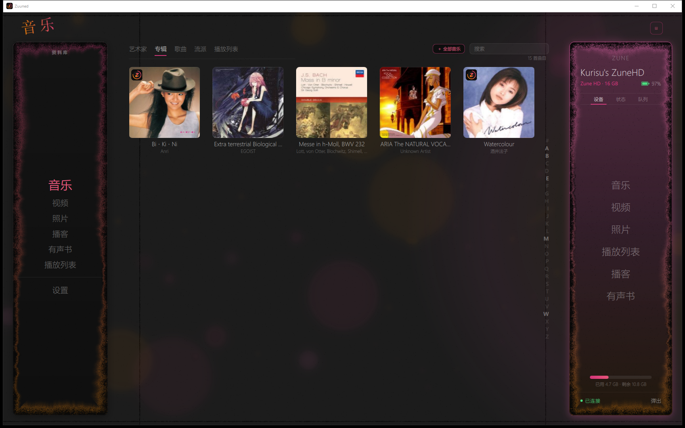
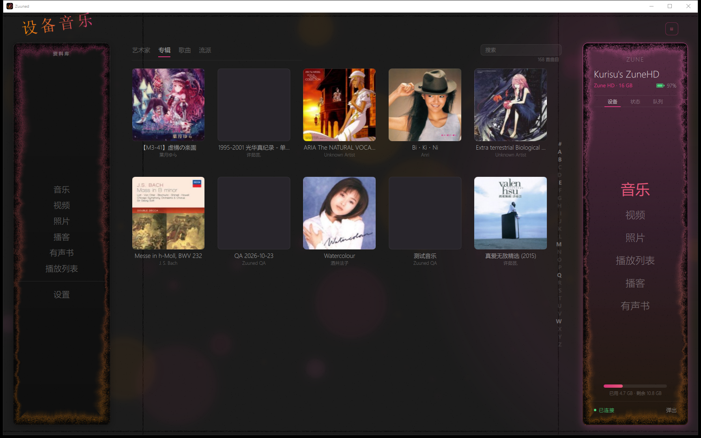
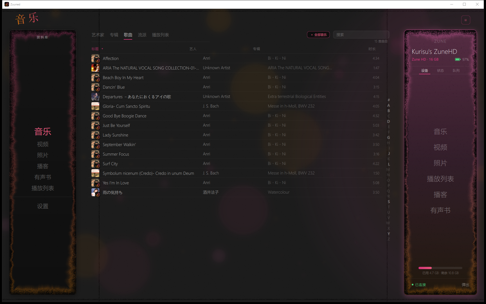
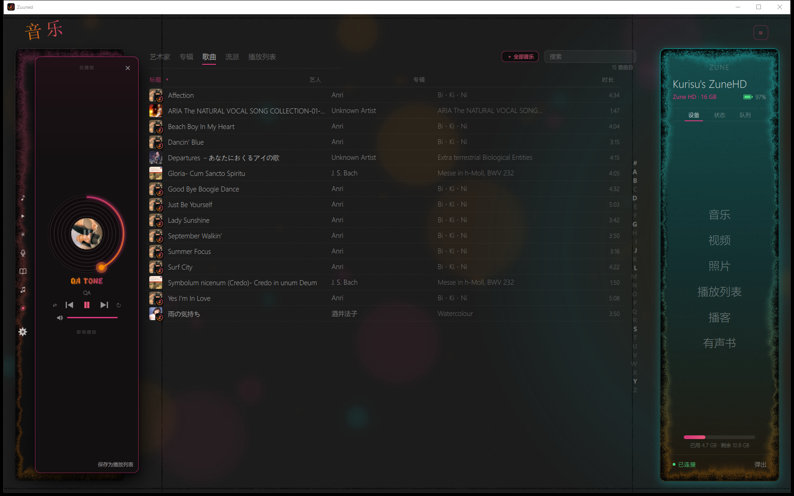
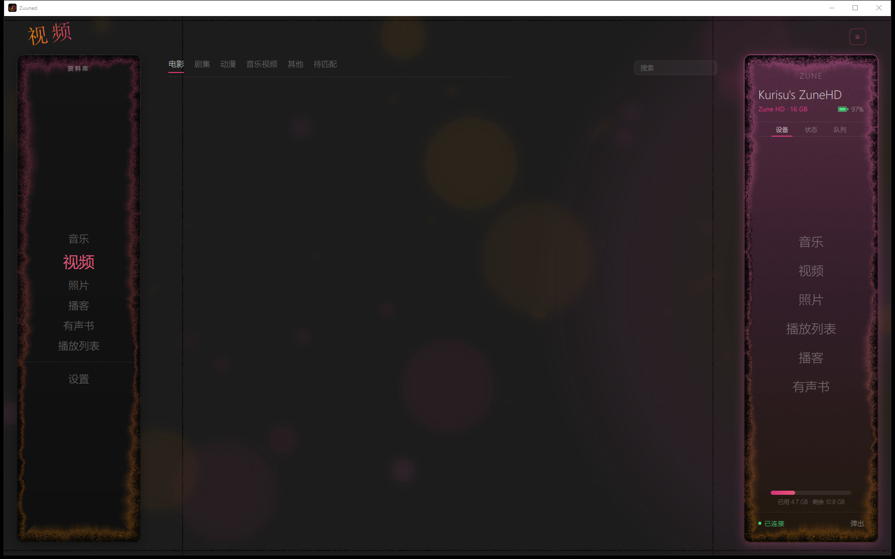
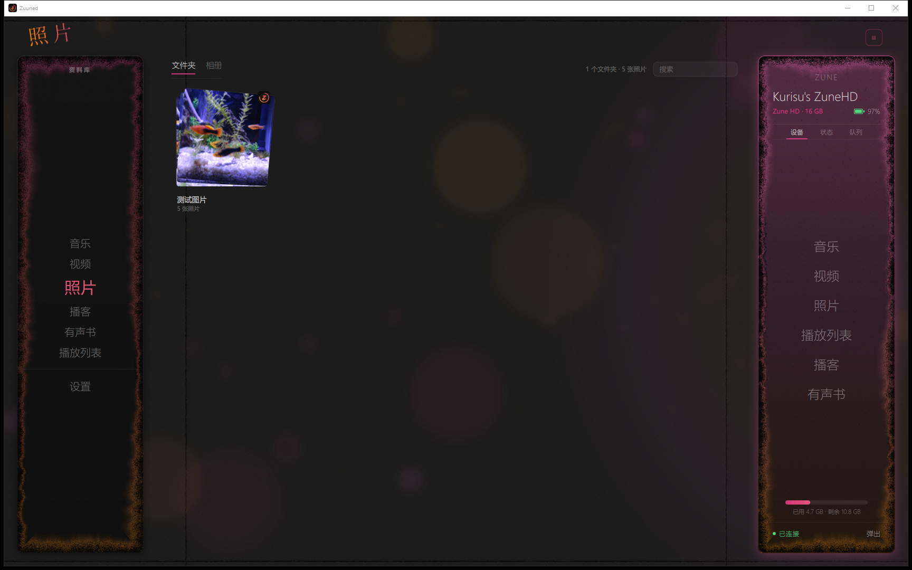
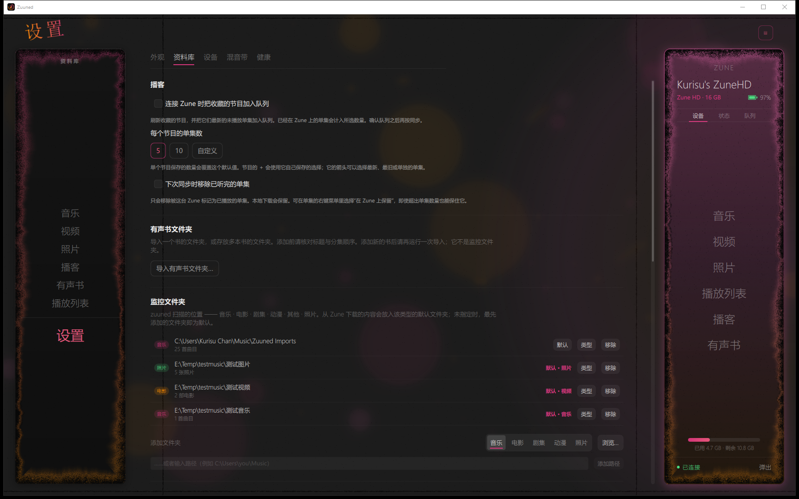

> **公共源码快照：**凭据要求以及与私有构建的差异请读 [PUBLIC_SOURCE.md](PUBLIC_SOURCE.md)。

[English](README.md) · **简体中文**

# Zuuned Modern

**让你的 Zune 重回这场反叛——在 Windows 上。**

Zuuned Modern 是 [Zuuned Linux](https://github.com/badgeromen/zuuned-linux) 的 **Windows
客户端移植**，Zuuned Linux 是社区为微软 Zune 播放器写的管理应用。这里是同一个
Qt 6 / QML 与 C++ 应用，也是同一套 [libzune](https://github.com/badgeromen/libzune)
PTP/MTP/MTPZ 协议栈，用 MSVC 在 Windows 上原生构建、原生运行——没有 WSL，没有 MinGW，
没有 Cygwin，没有虚拟机。

一套源码同时服务两个平台。Windows 的部分全是增量：一个 `compat/win/` 层，让 libzune 和
转码 C 层继续写它们所依赖的 POSIX 接口；一条 Windows 设备在位检测路径；以及贯穿全局的原生
路径与编码处理。Linux 那条线属于上游，本仓库负责把移植带着走，直到上游愿意接手。

本文件与 [README.md](README.md) 里的每一张图，都是在 Windows 上用本仓库构建出的
`zuuned.exe` 截取的，并且当时插着一台 Zune HD。



*音乐页的专辑视图：封面从本地文件里读出来，歌曲行带着同一批封面，右侧面板里是一台通过
WinUSB 连接的 Pavo 世代 Zune HD。*

[移植状态](docs/WINDOWS_PORT.md)——**在本仓库相信任何硬件结论之前，先读那一页。**它按能力
逐项记录：哪些是在 Windows 机器上对真实播放器做过的，哪些至今只在 Linux 上做过。

## 你能用 Zuuned 做什么

通过 USB 浏览 Zune 的资料库并往里传媒体；享受一个有艺术家、专辑、播放列表和本地播放的本地
音乐库；整理视频、播客与有声书；编辑元数据与封面；组建照片相册。不接播放器时，本地播放与
整理照常工作，并且每一类媒体只有一个默认目标目录——那一个目录在自己的行上把这个事实显示成
状态，其余目录把它显示成一个按钮。同步到播放器时，音频按
**设置 -> 设备 -> 音频转换** 里选定的规格转码，WMA 无损也在其中；那个目标由 Windows 本来就
自带的那个编码器写出来，而不是随程序附带一个编码器，做不到就直接拒绝，不会悄悄降级成有损。
Windows 移植已经与播放器双向传过音乐；照片与视频从
Windows 发过去过，但一个字节都没有回来过；Windows 上的删除至今一次都没做过——见状态页。

## 各个界面

| | |
| --- | --- |
|  | **设备页。**播放器里真实存在的东西——艺术家、专辑、歌曲与流派都在 Zune 上浏览，专辑图也是从 USB 取来的，不是去哪里查出来的。 |
|  | **歌曲列表。**每首歌一行，各自带缩略图，可排序、可搜索，队列用的就是这些行。 |
|  | **正在播放。**资料库上方的那张黑胶岛。这里的播放行来自应用自己的 QA 钩子，所以它标的是 `QA tone`，不是标签里的名字。 |
|  | **视频**，以及每部影片在放进播放器之前要转换成的目标 profile。 |
|  | **照片**，以及你为播放器用它们组建的照片相册。 |
|  | **设置 - 资料库。**监控文件夹按 Windows 的写法显示，每一类媒体一个默认目标目录，以及播客与有声书导入。 |

其余截图，想看原始尺寸的话：
[欢迎页](docs/readme-screenshots/zh/welcome.png)、
[艺术家](docs/readme-screenshots/zh/music-artists.png)、
[设备艺术家墙](docs/readme-screenshots/zh/device-music.png)、
[播客](docs/readme-screenshots/zh/podcasts.png)、
[有声书](docs/readme-screenshots/zh/audiobooks.png)、
[设置 - 外观](docs/readme-screenshots/zh/settings-appearance.png)、
[设置 - 设备](docs/readme-screenshots/zh/settings-device.png)、
[设置 - 混音带](docs/readme-screenshots/zh/settings-mixtapes.png)、
[设置 - 健康](docs/readme-screenshots/zh/settings-health.png)。
英文原图在 [docs/readme-screenshots/](docs/readme-screenshots)。

## 界面语言

**设置 -> 外观 -> 语言**把界面写成英文或简体中文，或者跟随 Windows 的显示语言。它只在启动时
读取一次，卡片上写明了这一点，并告诉你屏幕上现在是哪一种。

措辞是一个文件，不是一次代码改动：`i18n/zh_CN.tsv` 保存每一条消息和它的中文，
`i18n/zuuned_zh_CN.ts` 是由它生成的 Qt 翻译源，`python i18n/audit.py` 会在有任何界面文字被
直接写进 QML 或 C++（翻译永远够不着的地方）时让整棵树失败。所以改界面措辞就是改一个文件再
重启，加第三种语言就是加一个文件，而不是一次重构。见 [docs/I18N.md](docs/I18N.md)。

名字、标签、文件路径以及 Zune 自己显示的内容永不翻译——只翻译 zuuned 自己说的话。

## 在 Windows 上实际做到了哪一步

在开发机上对一台 Pavo 世代的 Zune HD 做过手工实测：

- **驱动绑定**——播放器绑定到 WinUSB，读回 `CM_PROB_NONE` 和一个接口 GUID
  （[`packaging/windows/DRIVER_INSTALL.md`](packaging/windows/DRIVER_INSTALL.md)）。
- **枚举与热插拔**——拔下再插上，两次得到同一份读取结果。
- **读取设备**——`GetDeviceInfo`、ZMDB 扫描、设备页可以浏览，专辑缩略图取自播放器本身。
- **带鉴权的传输，两个方向，用的就是普通控件**——两首歌发进播放器，其中一张专辑的名字是
  中文；另一首从设备拉回本地资料库并做了逐字节回读。拉取落在资料库为音乐声明的那个目录里，
  不是应用自己挑的一个目录。
- **Windows 磁盘上的本地资料库**——监控文件夹、`E:\...` 原生路径显示、非 ASCII 文件名、
  专辑封面。

**在 Windows 上尚未证实**，也不会从 Linux 继承过来：删除与清理、播客、有声书、照片和视频这些
传输类别、那台 Pavo 之外的每一个 Zune 型号、听得见的播放（自动化门禁是静音打开 WASAPI 的，
所以没有任何一次测试真正听过声音）、在播放器上播放一个 WMA 无损曲目，以及打包——目前还没有
Windows 安装包，所以今天这个移植是一个从源码构建的项目。**WMA 无损**在 Windows 上是可以编码的，
用的是操作系统自带的那个编码器，而不是随程序附带一个编码器；实测到的是 PCM 往返逐位相同，还没有
做到的是让播放器真的放出一个来。这个格式只有 Zune HD 有文档支持，所以设置项里也明说了：在别的
机型上更可能的结果是那一首不出声。

## 让 Windows 认出 Zune

没有绑定驱动的 Zune，libusb 看不见，而 Windows 自己不带这个驱动。未绑定的播放器停在 PnP
*问题 28*，在任何设备列表里都不出现。绑定是每台机器一次的手工步骤，而且
**Zuuned 里没有任何东西会安装驱动**：

1. 插上播放器，运行 [`packaging/windows/check-driver.ps1`](packaging/windows/check-driver.ps1)
   看看 Windows 认为自己手上是什么。
2. 如果它未绑定，照
   [`packaging/windows/DRIVER_INSTALL.md`](packaging/windows/DRIVER_INSTALL.md) 做——短版本是
   *用 Zadig，并选中那个脚本打印出来的设备 id*。不要手写 INF，也不要装 Zune 软件。
3. 重新插拔。之后应用会直接说清它能不能用当前插着的东西。

## 在 Windows 上构建

完整、当前的配方是
[BUILDING.md 的 Windows 一节](BUILDING.md#build-on-windows)。简版：

- Visual Studio 2022（`msvc2022_64`）、CMake、Ninja
- 面向 MSVC 2022 64 位的 Qt 6.11
- 一个 vcpkg 树，或一个 `ZUUNED_WIN_DEPS` 树，提供 libusb、libgcrypt、SQLite、mpv、FFmpeg
  和 LAME
- 配置之前先加载 MSVC 环境（`vcvars64.bat`）——完全不加载，或者加载了另一个 Visual Studio
  的那一套，报错形式是一大片假的 `std::thread` 诊断，或者一个 `STL1001` static assert，而不
  是链接错误
- MTPZ 鉴权数据，除非你只要只读那一种情形。这份源码不带任何凭据，因此没有凭据的构建可以浏览
  播放器，但一旦对它写入就返回 `AccessDenied` 或裸的 `0x200F`：症状读起来像平台故障，而它
  并不是。把那五行文件放到 `%USERPROFILE%\.mtpz-data`，无需重新构建；或者创建
  `libzune\src\mtpz_keys.h`——见 [docs/BUILD_WITH_MTPZ.md](docs/BUILD_WITH_MTPZ.md)

```powershell
git clone https://github.com/miemiekurisu/zuuned-modern.git
cd zuuned-modern
cmake -B build -G Ninja
cmake --build build --clean-first
build\zuuned.exe
```

在这个平台上 `--clean-first` 不是风格偏好：在本地化过的 Windows 安装上 Ninja 记录到的头文件
依赖是零，所以改完头文件做一次增量构建，会安静地链接上陈旧的目标文件。`BUILDING.md` 里有
解释，并附上上游 issue 编号。

树里带两个纯软件门禁，两个都不碰播放器：

```powershell
pwsh -NoProfile -ExecutionPolicy Bypass -File tests\win-compat\run.ps1
pwsh -NoProfile -ExecutionPolicy Bypass -File tests\win-usability\run.ps1
```

它们覆盖 POSIX 兼容层，并在隔离的 profile 里启动每一个页面、每一个设置页签、文件名与资料库
探针，以及跑在它内部的命令行自检——`librarytool names`、`paths`、`customize`、`folders`、
`vanish`、`videofloor`、`census`、`cover`、`net`，`transcodetool retagcheck` 与 `copycheck`，
还有 `mtpframingtool`。2026-10-29 的一次全绿运行报出 `201 checks, 0 failures, 0 skips` 和
`launches=18 checks=134 failures=0 skips=1 killed=0`，那一个 skip 是没接 Zune 时跳过的
那两条点名具体设备的检查。这些计数会随代码移动，请把它们当下限而不是预期值。两个门禁对
Zune 一个字都不说——这是故意的，也正是硬件证据放在
[docs/WINDOWS_PORT.md](docs/WINDOWS_PORT.md) 而不是这里的原因。

## 在 Linux 上构建

上游的说明依然适用，移植没有改动它们：见 [BUILDING.md](BUILDING.md)、Zune 鉴权数据的
[docs/BUILD_WITH_MTPZ.md](docs/BUILD_WITH_MTPZ.md)，以及上游
[badgeromen/zuuned-linux](https://github.com/badgeromen/zuuned-linux) 仓库里的 Linux 发行包、
AppImage 工作流和 udev 规则。本仓库也能构建 Linux，但不发布任何 Linux 二进制。Linux 那一侧
的软件门禁同样在树里：`ci/check.sh` 会在 Linux 机器上驱动 `tests/` 下的其余目录——音乐导入
与同步、封面、有声媒体、播放列表、诊断等等——那也是那套门禁唯一跑得起来的地方。

## 报告问题

打开 **设置 -> 健康 -> 导出调试报告**，把保存下来的文本读一遍，附到这里的 issue 上。请说明
平台与构建、Zune 型号和复现步骤。日志在 Windows 上是
`%LOCALAPPDATA%\Zuuned\Zuuned\State\logs\`，在 Linux 上是
`~/.local/state/Zuuned/Zuuned/logs/`；设置是 Windows 上 `%APPDATA%\Zuuned` 下的一个 ini
文件。报告永远不会自己上传。见 [docs/DIAGNOSTICS.md](docs/DIAGNOSTICS.md)。

## 目录结构

```
src/            C++；DeviceService（libzune 桥）、应用入口
qml/            界面；Theme.qml 是设计 token
compat/win/     Windows 的 POSIX 接口面，只构建一次，产物是 zuuned_wincompat
libzune/        随源码附带；共享的 C 协议库
libzune/tools/  zunetool 与 mtpframingtool，协议侧的探针
transcode/      FFmpeg 与 LAME 转码，外加系统自带的 WMA 无损编码器
i18n/           界面措辞；zh_CN.tsv 是可编辑的源
packaging/      Linux USB 规则、PKGBUILD 与 AppImage 构建器
packaging/windows/  WinUSB 驱动指南与 check-driver.ps1
tests/win-compat/    Windows 兼容性门禁（不碰设备）
tests/win-usability/ Windows 启动与界面门禁（不碰设备）
tests/            Linux 门禁套件，由 ci/check.sh 驱动（不碰设备）
docs/readme-screenshots/  这些截图，以及 zh/ 那一套
docs/WINDOWS_PORT.md 在 Windows 上证实了什么、没证实什么
docs/WINDOWS_COMPAT_AUDIT.md 全树的 Windows 兼容性排查
docs/SETTINGS_INVENTORY.md 每一个开关，以及每个开关背后的功能
docs/FEATURE_COMPLETION.md 实现待办清单
docs/ZUNE_CLIENT_FEATURES.md 原版 Zune 软件，逐项功能对照
```

## 许可

Zuuned 原始应用代码以 **GPL-3.0-or-later** 授权，见 [LICENSE](LICENSE) 与
[许可范围](COPYING.md)。第三方组件保留各自的许可与署名。libzune 有它自己的仓库。

Zuuned 是一个独立的社区项目，与微软无关联，也未获微软背书。Zune 是微软公司的商标。
